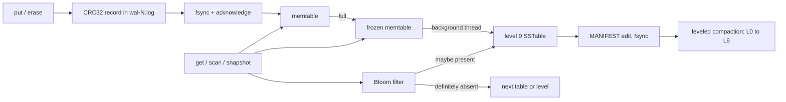

# lsm-tree

A dependency-free C++17 log-structured merge-tree storage engine built from
first principles.

[](https://github.com/Eyeroniq/lsm-tree/actions/workflows/ci.yml)


> A write is not complete because it reached a map. It is complete when a
> restart can prove it survived.

## What is actually implemented

- acknowledged writes survive process crashes **and simulated power loss**
  through an `fsync`-backed, checksummed WAL;
- sorted memtables flush to immutable, checksummed SSTables made of ~4 KB
  prefix-compressed data blocks with restart points; only a sparse block
  index and the Bloom filter stay in memory, and a point read loads one block;
- a sharded LRU block cache with a byte budget keeps hot blocks in memory;
- Bloom filters reject absent keys before table lookup;
- leveled compaction: level 0 holds fresh flushes, and each deeper level holds
  disjoint ~2 MB tables in a budget 10x the level above, so compaction
  rewrites only the tables whose ranges overlap;
- an append-only, checksummed `MANIFEST` log records which tables are live and
  at which level; every flush and compaction commits with one fsynced edit
  before any input is deleted;
- **snapshots**: a consistent point-in-time view that keeps seeing the data it
  was taken on through later writes, flushes and compactions;
- **thread-safe**: reads run in parallel with each other and with writes, and
  flushes and compactions run on a background thread, so writers never wait
  for a compaction;
- tombstones prevent deleted values from resurfacing, and are dropped once no
  snapshot needs them and no older version can lie beneath them;
- incomplete WAL and `MANIFEST` tails are detected and repaired to the last
  verified record;
- SSTable and `MANIFEST` corruption is rejected instead of silently returning
  suspect data;
- an exclusive `LOCK` file stops a second process from opening the same
  database directory;
- an optional Spring Boot service exposes the engine over HTTP (see
  [HTTP service](#http-service-spring-boot)).



## Measured, not implied

| Check | Result |
|---|---:|
| Correctness assertions (g++, clang, ASan + UBSan, ThreadSanitizer) | **8,108 passed** in each build |
| Seeded differential operations | 2,000 across five restarts |
| Randomized hard-crash rounds | 1,000: 32,540 acknowledged writes, up to 839 live tables |
| Simulated power cuts | 400 |
| Acknowledged writes lost, either campaign | **0** |
| Durability steps whose removal the power-cut campaign detects | **5 of 5** |
| Benchmark records recovered | 20,000 / 20,000 |

Point reads, 20,000 seeded random reads of 20,000 keys (`make benchmark`),
median of three runs on WSL2 Ubuntu 26.04 with g++ 15, against the previous
release on the same machine:

| Configuration | Previous release | This release |
|---|---:|---:|
| Block cache off: every read loads and verifies a block | 82K ops/s | **~110K ops/s** |
| Block cache on (default 8 MiB), one thread | 2.77M ops/s | 2.11M ops/s |

Restart points make an uncached read decode at most eight entries instead of
a whole block. A cached read on one thread is about 20% slower than before:
taking the database lock and pinning the current table set on every read is
what makes reads safe alongside writers and the background thread. In
exchange, reads now scale across threads (the previous engine could not be
shared between threads at all):

| Reader threads (12-core machine, 200,000 cached keys) | 1 | 2 | 4 | 8 |
|---|---:|---:|---:|---:|
| Point reads per second | 1.50M | 2.64M | **3.11M** | 2.96M |

Write amplification, loading random keys with 100-byte values and `fsync`
off, measured as bytes the process wrote per byte of user data:

| Keys loaded | Full compaction (two releases ago) | Leveled, previous release | This release |
|---|---:|---:|---:|
| 100,000 (11 MB) | 27x | 22x | **18x** |
| 300,000 (33 MB) | 77x | 35x | **33x** |

Writes with `fsync` are bound by the disk: WSL's virtual disk acknowledges an
fsync almost immediately on this machine (both releases measured 0.85M-0.9M
writes/s, within run-to-run noise of each other), while an Apple M2 Pro
measured 34,708 writes/s two releases ago.
These are local measurements, not universal hardware claims.

## Verify it

```bash
make test            # 8,108 assertions
make asan-test       # the same under AddressSanitizer + UBSan
make tsan-test       # the same under ThreadSanitizer
make crash-test      # SIGKILL campaign
make powercut-test   # simulated power loss (Linux)
make benchmark
```

The crash campaign deliberately splits WAL, SSTable and `MANIFEST` writes
into seven-byte chunks, kills the writer with uncatchable `SIGKILL` at seeded
random times, and compares every recovered state with a separately synced
acknowledgement oracle. Half the rounds run long enough for flushes and
compactions to be in flight when the kill lands, and the campaign fails if it
never observes an SSTable, so it cannot quietly degrade into a WAL-only test.

A killed process cannot prove an fsync is in the right place, because the
kernel still writes back what it was given. The power-cut campaign can: see
[Simulated power loss](#simulated-power-loss).

```bash
CRASH_ROUNDS=1000 make crash-test
POWERCUT_ROUNDS=1000 make powercut-test
```

## Disk structures

```text
wal-N.log   one per memtable; a legacy active.wal is replayed first
  [magic | sequence | put/delete | key_len | value_len | payload | CRC32]...

MANIFEST    an append-only log of records
  [magic | version]
  [payload_len | type | payload | CRC32]...
    snapshot: [next_generation | count | entry...]           (first record)
    edit:     [next_generation | removed generations | added entries]
    entry:    [generation | level | smallest_key | largest_key]

sst-N.dat   version 3, written by this release
  [magic | version]
  data blocks, each ~block_bytes:
    [shared varint | unshared varint | value_len varint |
     (sequence << 1 | tombstone) varint | key suffix | value]...
    [restart offset]... [restart count] [CRC32]
  index, one entry per block:  [key_len | last_key | offset | size]... [CRC32]
  [Bloom filter bytes]
  footer (64 bytes):
    [index offset/size | bloom offset/size | entry_count | max_sequence |
     bloom bits/hashes | footer magic | CRC32]
```

Version 3 blocks store each key as the bytes it does not share with the
previous key; every eighth entry stores its whole key and is a restart point.
Entries are ordered by key, and versions of one key by descending sequence.

Older formats stay readable. Version 2 tables (fixed 20-byte entry headers,
one version per key) and version 1 tables (one whole-file CRC, loaded into
memory) are rewritten as version 3 by the next compaction. A version 1
`MANIFEST` (a single snapshot) is upgraded on open, and a directory with no
`MANIFEST` at all becomes level 0 in generation order.

## Honest boundary

This is a compact educational engine, not a RocksDB replacement. Writes are
applied one at a time; a single background thread does every flush and
compaction; a single-threaded cached read pays a lock and a reference-count
pin that an RCU-style design would avoid; values are not compressed; and
snapshots live in memory only, ending when the database is closed.

No database, serialization library, checksum package, Bloom-filter package, or
test framework is hidden behind the implementation. The optional HTTP service
in `server/` uses Spring Boot, but the engine itself stays dependency-free.

## Why the write order is the design

The interesting part of an LSM tree is not putting values in `std::map`. It is
moving an acknowledged value from one durable representation to another
without creating a moment where neither copy is valid.

```text
open
  0. create wal-N.log, fsync the directory   <-- the log's name is durable

put(key, value)
  1. append checksummed record to wal-N.log
  2. fsync wal-N.log                       <-- acknowledgement boundary
  3. insert into the memtable

memtable full (writer)
  4. create wal-(N+1).log, fsync the directory
  5. freeze the memtable; new writes go to a new memtable and wal-(N+1).log

flush (background thread)
  6. write sst-G.dat.tmp in key order, fsync it
  7. rename to sst-G.dat, fsync the directory
  8. append a MANIFEST edit adding sst-G, fsync   <-- table is now live
  9. delete wal-N.log
```

A crash before step 2 means the operation was never acknowledged. A crash
between 2 and 8 replays it from the WAL; a table renamed in step 7 but not
yet in the `MANIFEST` is an orphan and is deleted on open. A crash between 8
and 9 replays data that is also in a table, which is harmless: the same
sequence number in two places is merged as one version. Only after the
`MANIFEST` edit naming the table is durable is its log deleted.

Step 0 exists because the power-cut campaign found it missing: the WAL was
created after the directory's last fsync, so its name -- and every write
acknowledged into it -- could vanish in a power cut before the first flush.

Compaction follows the same rule: outputs are written, synced, renamed and
the directory synced; one `MANIFEST` edit swaps outputs in and inputs out;
only then are the input files deleted. Before the edit the inputs are live;
after it the outputs are. There is no instant where both or neither count.

This is why the code uses POSIX file descriptors instead of `ofstream` for the
durability path. Flushing a C++ stream moves bytes to the kernel; it does not
establish the persistence boundary the API promises.

## The MANIFEST log

The `MANIFEST` starts with a snapshot of every live table and then grows by
one small edit per flush or compaction. When it passes 64 KiB and four times
its snapshot, it is rewritten as a single snapshot (temporary file, fsync,
rename, directory fsync).

On open, an incomplete or checksum-failing *final* record is an edit that was
never committed, and is dropped. A damaged record anywhere else, or in the
initial snapshot, fails the open: trusting a prefix would make newer live
tables look like orphans, and orphans are deleted.

## SSTable anatomy

Tables are immutable after their temporary file is renamed. They are written
by streaming sorted entries into data blocks, each with its own CRC32. Blocks
are cut only between different keys, so all versions of a key share a block
and index keys stay strictly increasing. The index, Bloom filter and a fixed
64-byte footer close the file. Writing needs one block of memory, whatever
the table size.

Opening a table reads only the footer, index and Bloom filter. It checks
their CRCs, requires the blocks to tile the data region exactly, and requires
strictly increasing index keys. A corrupt footer or index fails open; it is
never silently skipped, because skipping a newer generation could resurrect
an older value.

A point read binary-searches the index for the first block whose last key is
at least the target, reads that block, verifies its CRC, binary-searches its
restart points and decodes at most eight entries. A damaged data block is
reported on the read that touches it, instead of returning suspect data.
Compaction reads every block, so it also fails on any damaged block rather
than copying it forward.

Verified blocks are cached in their compact form, in 16 independently locked
shards. Compaction bypasses the cache so that a full rewrite does not evict
the blocks serving reads.

## Bloom filters

Each table chooses at least 64 bits and otherwise uses
`keys × bits_per_key`. Seven double-hashed probes are used at the default ten
bits per key. The second hash is forced odd so the probe sequence does not
collapse onto a small subset of a power-of-two bit array.

A negative result is definitive and skips the table search. A positive result
is only permission to look: false positives are expected. Tests query every
inserted key to establish zero false negatives, then issue absent lookups and
assert that the negative-hit counter moves.

## Reads, snapshots and concurrency

Every write gets the next sequence number. A read asks for the newest version
of a key with a sequence no greater than its bound: the latest sequence for a
plain read, or the snapshot's sequence for a snapshot read. Shallower levels
and newer level-0 tables always hold newer data, so the first visible version
found -- memtable, frozen memtable, level 0 newest first, then at most one
table per deeper level -- is the right one. Finding a tombstone ends the
search; continuing would expose the value it deleted.

`scan(begin, end)` reconciles every layer to the newest visible version of
each key in `[begin, end)`, removes tombstones only from the returned view,
and returns sorted keys. An empty end means no upper bound.

A snapshot only records a sequence number. What keeps its view intact is
garbage collection: flush and compaction drop a version only when a newer
version of the same key is visible to every reader (the oldest live
snapshot, or everyone when there is none). With no snapshots, only the
newest version of each key survives, exactly as before.

A reader locks only to search the live memtable and to pin the frozen
memtable and the current table set; it then searches those without a lock.
A pinned table stays readable even if compaction deletes its file, because
its descriptor stays open. Writers take a separate lock, so a writer's fsync
never blocks a reader. One background thread does every flush, compaction
and `MANIFEST` commit, so the table set changes one step at a time.

## Levels, and when a tombstone may go

Level 0 holds tables exactly as flushed; they may overlap, and newer ones
shadow older ones. Every deeper level holds tables with disjoint key ranges,
and each level holds older data than the one above it.

When level 0 reaches `compaction_trigger` tables, all of them merge with the
level 1 tables their combined range touches. When a deeper level exceeds its
byte budget, one of its tables (chosen round-robin through the key space)
merges with the overlapping tables one level down. If nothing overlaps, the
table moves down by a `MANIFEST` edit alone, without being rewritten.

A tombstone must survive for as long as an older version of its key could
exist below it, or a snapshot could still need the value it hides.
Compaction drops a tombstone only when no snapshot predates it and no table
in any level below the output overlaps the key. That proof depends on the
`MANIFEST`: a replacement and its sources are never live at the same time,
so a lookup can never miss the tombstone in one and fall through to an old
value in the other. `compact()` merges everything into the deepest level, so
it drops every tombstone no snapshot needs, along with the versions it hid.

## Simulated power loss

`scripts/powercut/powercut.c` is an `LD_PRELOAD` shim (Linux) that wraps
`fsync()` for files in the database directory and records what each call
made durable under strict POSIX rules: `fsync(file)` makes that file's
contents durable; `fsync(directory)` makes its names durable. Nothing else
is. Contents are keyed by inode and birth time, so a reused inode number is
never mistaken for an old file.

After each kill, `scripts/powercut_torture.py` rebuilds the directory from
those records alone -- unsynced data and unsynced names vanish, as after
losing power -- and every acknowledged write must still be readable. A third
of the cuts land right after a randomly chosen fsync, either of any kind or
of one kind (`MANIFEST`, directory, table), so rare steps such as a
compaction's `MANIFEST` commit are cut often; the rest land at random times.
Every 25 rounds the database starts over, so cuts also land before a first
flush.

The campaign has teeth: deleting any one of these five durability steps from
the engine makes it fail, each with the symptom a real power cut would cause.

| Step removed | Failure |
|---|---|
| directory fsync after creating a WAL | acknowledged write lost |
| fsync of a finished SSTable | `unsupported SSTable header` |
| directory fsync after a flush renames its table | `MANIFEST references missing table` |
| directory fsync after compaction renames its outputs | `MANIFEST references missing table` |
| fsync of an appended `MANIFEST` edit | acknowledged write lost |

## Verification strategy

The 8,108 assertions include:

- values, overwrites and deletes across process reopen;
- range scans before flush, after flush, after reopen and after compaction;
- Bloom-filter no-false-negative checks;
- checksum rejection after single-byte SSTable corruption, and a corrupted
  data block that fails only the reads touching it;
- damaged WAL tail repair, and a WAL append cut short by a file-size limit
  rolled back so later acknowledged writes survive;
- a second open of a locked database directory is refused;
- hand-built version 1 and version 2 tables are read, then migrated to
  version 3 by compaction;
- prefix compression brings tables with shared key prefixes under 70% of the
  raw key and value bytes, and restart points find every key, every gap
  between keys and every range start inside one large block;
- 2,000 seeded random mutations checked against `std::map` through five
  reopen cycles, with 64-byte blocks, 256-byte tables and a 512-byte level 1
  so data moves through every level;
- the `MANIFEST` appends one small edit per flush, stays bounded through
  thousands of edits, ignores a torn final record, fails on a damaged middle
  record without deleting anything, and upgrades the previous format;
- a table missing from the `MANIFEST` is ignored and deleted even though it
  has the newest generation;
- snapshots see a frozen view through overwrites, deletes, flushes and full
  compactions; released snapshots let old versions go; a tombstone is kept
  while a snapshot needs the value it hides;
- two writers, four readers and a thread calling `flush()` and `compact()`
  at once: every acknowledged write is readable, and every snapshot holds
  exactly keys 0..m-1 of each writer, with no gaps.

The crash harness is deliberately external. A Python parent launches a writer,
enables seven-byte physical writes, waits a seeded random interval, sends
uncatchable `SIGKILL`, and opens the database in another process. Every
independently synced oracle entry must still be readable.

The WAL can legitimately contain one more value than the oracle if the process
dies after database `fsync` but before oracle `fsync`. The harness treats that
interval as ambiguous success, never as loss.

## API

```cpp
lsm::Options options;
options.memtable_bytes = 64 * 1024;
options.bloom_bits_per_key = 10;
options.compaction_trigger = 4;            // level 0 tables before compacting
options.table_bytes = 2 * 1024 * 1024;     // target size of compacted tables
options.level1_bytes = 10 * 1024 * 1024;   // level 1 budget
options.level_multiplier = 10;             // each level 10x the one above
options.block_bytes = 4096;
options.block_cache_bytes = 8 * 1024 * 1024;

lsm::LSMTree db("data", options);          // safe to share between threads
db.put("customer:42", "active");
db.erase("customer:17");

auto one = db.get("customer:42");
auto page = db.scan("customer:", "customer;");

auto snapshot = db.snapshot();             // a frozen view
db.put("customer:42", "closed");
auto then = db.get("customer:42", *snapshot);   // still "active"

db.flush();                  // memtable to a table, committed
db.compact();                // everything into the deepest level
db.wait_for_compactions();   // until no background work is pending
```

## Live dashboard

```bash
make demo                    # http://localhost:8080
make demo DEMO_PORT=18080    # if port 8080 is taken
```

`make demo` starts the HTTP service on a fresh database with deliberately
tiny memtables, tables and levels, and serves a dashboard at the root URL:

- **the tree, live**: the memtable filling up and every level L0-L6 drawn as
  table chips, so flushes and compactions are visible as they happen;
- **live counters**: writes, tables, Bloom-filter skip rate, block-cache hit
  rate and bytes rewritten by compaction, with a writes-per-second sparkline;
- **an activity feed** narrating each flush, compaction and trivial move;
- **buttons** to write or read 5,000 random keys, flush and compact, plus a
  key explorer and a prefix range scan.

It is plain HTML, CSS and JavaScript served by the same Spring Boot app, with
no build step and nothing loaded from the network, in dark and light themes.

## HTTP service (Spring Boot)

`server/` is a Spring Boot 4 application on Java 25 that serves the engine over
HTTP. It calls the C++ library in-process through Java's Foreign Function &
Memory API, so there is no JNI glue and no second process. The C ABI it binds
to is `bindings/lsm_c.h`; C++ exceptions are converted to status codes there
and never cross into Java.

```bash
make shared        # build/liblsm.so (or .dylib on macOS)
make java-test     # JUnit: FFM binding + HTTP API against the real engine
make server        # http://localhost:8080
```

| Method | Path | Purpose |
|---|---|---|
| `PUT` | `/api/v1/kv/{key}` | write the request body; 204 once fsynced |
| `GET` | `/api/v1/kv/{key}` | read a value; 404 if absent or deleted |
| `DELETE` | `/api/v1/kv/{key}` | delete a key |
| `GET` | `/api/v1/kv?from=&to=&limit=` | scan `[from, to)` as JSON |
| `POST` | `/api/v1/admin/flush`, `/api/v1/admin/compact` | maintenance |
| `GET` | `/api/v1/admin/stats` | engine counters, including tables per level |
| `POST` | `/api/v1/demo/load?count=`, `/api/v1/demo/read?count=` | random load for the dashboard |

Interactive docs are at `/swagger-ui.html`, health at `/actuator/health`, and
the engine counters are published as Micrometer metrics (`lsm.sstables`,
`lsm.memtable.entries`, `lsm.sequence`, `lsm.bloom.checks`,
`lsm.bloom.negatives`) under `/actuator/metrics`.

The engine is thread-safe, so HTTP requests run in parallel: every call takes
a shared read lock, and only closing the store takes the write lock. The
engine's `LOCK` file means only one service instance can own a data
directory. Keys and values are treated as UTF-8 text at the HTTP layer.

Settings bind from `application.properties` or environment variables:
`LSM_DATA_DIR`, `LSM_LIBRARY_PATH`, `LSM_MEMTABLE_BYTES`,
`LSM_COMPACTION_TRIGGER`, `LSM_TABLE_BYTES`, `LSM_LEVEL1_BYTES`,
`LSM_SYNC_WRITES`. The `demo` profile (`application-demo.properties`) sets
tiny sizes for the dashboard.

```bash
docker build -t lsm-tree-server .
docker run -p 8080:8080 -v lsm-data:/data lsm-tree-server

curl -X PUT --data-binary 'Ada' localhost:8080/api/v1/kv/user:1
curl localhost:8080/api/v1/kv/user:1
curl 'localhost:8080/api/v1/kv?from=user:&to=user;'
```

`make smoke-test` builds the image and drives a real container over HTTP:
reads, writes, deletes and scans; a graceful restart; a `SIGKILL` after an
acknowledged write, which must still be readable afterwards; and a second
container on the same volume, which the `LOCK` file must refuse. CI runs it on
every push.

## Repository map

```text
include/lsm/lsm.h          public API, options, statistics and snapshots
src/lsm.cpp                WAL, MANIFEST, SSTables, levels, background thread
src/main.cpp               crash workload, oracle verifier and benchmark
tests/test_lsm.cpp         deterministic, randomized and concurrent tests
scripts/crash_torture.py   external process-kill campaign
scripts/powercut/          LD_PRELOAD fsync shim for simulated power loss
scripts/powercut_torture.py  power-cut campaign
bindings/lsm_c.h           C ABI over the engine for foreign callers
server/                    Spring Boot HTTP service (Java 25, FFM)
server/.../static/         the live dashboard (HTML, CSS, JavaScript)
Dockerfile                 engine library + service in one image
.github/workflows/ci.yml   engine, sanitizer, power-cut, Java and Docker jobs
```

## What would come next

- snapshots and range scans in the C ABI and the HTTP service;
- an iterator API, so a scan streams instead of building its whole result;
- read-side reclamation (RCU or epochs) to remove the per-read lock and pin;
- more than one background thread, so level 0 flushes never wait behind a
  long compaction;
- value compression per block.

Each changes the recovery proof. They are listed rather than implied.
