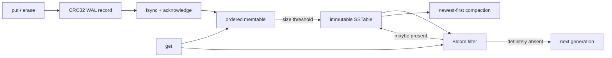

# lsm-tree

A dependency-free C++17 log-structured merge-tree storage engine built from
first principles.

[](https://github.com/Eyeroniq/lsm-tree/actions/workflows/ci.yml)


> A write is not complete because it reached a map. It is complete when a
> restart can prove it survived.

## What is actually implemented

- acknowledged writes survive process crashes through an `fsync`-backed,
  checksummed WAL;
- sorted memtables flush to immutable, checksummed SSTables made of ~4 KB
  data blocks; only a sparse block index and the Bloom filter stay in
  memory, and a point read loads one block from disk;
- an LRU block cache with a byte budget keeps hot blocks decoded in memory;
- Bloom filters reject absent keys before table lookup;
- newest-version-wins reads span memory and multiple disk generations;
- ordered range scans reconcile versions and tombstones across every layer;
- tombstones prevent deleted values from resurfacing;
- compaction durably installs a replacement before deleting old generations;
- incomplete WAL tails are detected and repaired to the verified record
  boundary;
- SSTable corruption is rejected instead of silently returning suspect data;
- an exclusive `LOCK` file stops a second process from opening the same
  database directory;
- an optional Spring Boot service exposes the engine over HTTP (see
  [HTTP service](#http-service-spring-boot)).



## Measured, not implied

| Check | Result |
|---|---:|
| Correctness assertions | **4,311 passed** |
| Seeded differential operations | 2,000 across five restarts |
| Randomized hard-crash rounds | 100 |
| Independently acknowledged writes lost | **0** |
| Benchmark records recovered | 20,000 / 20,000 |

Throughput, 20,000 `fsync`ed writes then 20,000 seeded random point reads
(`make benchmark`), median of three runs on WSL2 Ubuntu 26.04 with g++ 15:

| Configuration | Point reads | Writes |
|---|---:|---:|
| Block cache on (default 8 MiB) | **2.75M ops/s** | ~500 ops/s |
| Block cache off: every read loads and verifies a block | 87K ops/s | ~400 ops/s |
| Previous format, whole table in memory | 1.68M ops/s | ~410 ops/s |

The benchmark data (about 1 MB) fits in the cache, so the cached row is the
hot-set case; the uncached row is the floor when every read misses. Write
throughput is bound by `fsync` on WSL's virtual disk and varies by about
±20% between runs, so the write column shows no real difference. The same benchmark on
an Apple M2 Pro measured 34,708 writes/s with the previous format. These are
local measurements, not universal hardware claims.

## Verify it

```bash
make test
make crash-test
make benchmark
```

The crash campaign deliberately splits WAL and SSTable writes into seven-byte
chunks, kills the writer with uncatchable `SIGKILL` at seeded random times, and
compares every recovered state with a separately synced acknowledgement
oracle.

```bash
CRASH_ROUNDS=1000 make crash-test
```

## Disk structures

```text
active.wal
  [magic | sequence | put/delete | key_len | value_len | payload | CRC32]...

sst-N.dat (version 2, written by this release)
  [magic | version]
  data blocks, each ~block_bytes:
    [sequence | tombstone | key_len | value_len | key | value]... [CRC32]
  index, one entry per block:
    [key_len | last_key | offset | size]... [CRC32]
  [Bloom filter bytes]
  footer (64 bytes):
    [index offset/size | bloom offset/size | entry_count | max_sequence |
     bloom bits/hashes | footer magic | CRC32]

sst-N.dat (version 1, still readable)
  [magic | version | entry_count | bloom metadata]
  [Bloom filter bytes]
  [sequence | tombstone | key_len | value_len | key | value]...
  [whole-file CRC32]
```

Version 1 tables are loaded whole, as before. The next compaction rewrites
them as version 2, so existing databases migrate without a separate step.

Flush ordering is deliberate: write temporary table → `fsync` table → atomic
rename → `fsync` directory → reset WAL. Compaction follows the same
install-before-delete rule and retains tombstones, so an interrupted cleanup
cannot expose an older value.

## Honest boundary

This is a compact educational engine, not a RocksDB replacement. It currently
has one writer, keeps one index key per data block in memory, uses
size-triggered full compaction (now streamed block by block, but still
rewriting every table), and does not implement snapshots or concurrent
readers. The tests
focus on the invariants those future features must preserve.

No database, serialization library, checksum package, Bloom-filter package, or
test framework is hidden behind the implementation. The optional HTTP service
in `server/` uses Spring Boot, but the engine itself stays dependency-free.

## Why the write order is the design

The interesting part of an LSM tree is not putting values in `std::map`. It is
moving an acknowledged value from one durable representation to another
without creating a moment where neither copy is valid.

```text
put(key, value)
  1. append checksummed WAL mutation
  2. fsync WAL                         <-- acknowledgement boundary
  3. update ordered memtable

flush()
  4. write sst-N.dat.tmp in key order
  5. fsync temporary SSTable
  6. rename to sst-N.dat
  7. fsync database directory          <-- table name is now durable
  8. truncate + fsync active.wal
```

A crash before step 2 means the operation was never acknowledged. A crash
between 2 and 7 replays it from the WAL. A crash between 7 and 8 may leave the
same sequence in both places, which is harmless because sequence numbers make
replay idempotent. Only after the table and its directory entry are durable is
the old log discarded.

This is why the code uses POSIX file descriptors instead of `ofstream` for the
durability path. Flushing a C++ stream moves bytes to the kernel; it does not
establish the persistence boundary the API promises.

## SSTable anatomy

Tables are immutable after their temporary file is renamed. They are written
by streaming sorted entries into ~4 KB data blocks, each with its own CRC32.
When a block fills, its last key, offset and size go into the index. The
index, Bloom filter and a fixed 64-byte footer close the file. Writing needs
one block of memory, whatever the table size.

Opening a table reads only the footer, index and Bloom filter. It checks
their CRCs, requires the blocks to tile the data region exactly, and requires
strictly increasing index keys. A corrupt footer or index fails open; it is
never silently skipped, because skipping a newer generation could resurrect
an older value.

A point read binary-searches the index for the first block whose last key is
at least the target, reads that one block, verifies its CRC, checks that its
keys are strictly increasing and agree with the index, and then searches it.
A damaged data block is therefore reported on the read that touches it,
instead of returning suspect data. Compaction reads every block, so it also
fails on any damaged block rather than copying it forward.

Decoded blocks go into an LRU cache with a byte budget
(`Options::block_cache_bytes`). Compaction bypasses the cache so that a
full rewrite does not evict the blocks serving reads.

## Bloom filters

Each table chooses at least 64 bits and otherwise uses
`keys × bits_per_key`. Seven double-hashed probes are used at the default ten
bits per key. The second hash is forced odd so the probe sequence does not
collapse onto a small subset of a power-of-two bit array.

A negative result is definitive and skips the table search. A positive result
is only permission to look: false positives are expected. Tests query every
inserted key to establish zero false negatives, then issue absent lookups and
assert that the negative-hit counter moves.

## Reads and range scans

Point reads check the memtable first, then immutable generations newest to
oldest. Finding a tombstone ends the search; continuing would expose the value
that tombstone deleted.

`scan(begin, end)` performs last-sequence-wins reconciliation across the active
memtable and every immutable generation. It handles duplicate keys left by a
crash between table installation and WAL reset, removes tombstones only from
the returned view, and emits sorted keys in the half-open interval
`[begin, end)`. An empty end means no upper bound.

The test fixture updates one key in memory, deletes a second over an older
SSTable, scans before and after flush, reopens the database, compacts it, and
requires the same result at every stage.

## Why compaction retains tombstones

The engine writes a complete replacement generation and syncs it before
deleting sources. During a crash, replacement and sources may coexist.
Dropping a tombstone from the replacement would make lookup miss there, fall
through to an old source table, and resurrect the deleted value.

Retaining tombstones makes the overlap safe. Reclaiming them requires stronger
metadata proving that no older overlapping table contains the key. This engine
does not pretend to have that proof.

## Verification strategy

The 4,311 assertions include:

- values, overwrites and deletes across process reopen;
- newest-version-wins reads across multiple SSTables;
- range scans before flush, after flush, after reopen and after compaction;
- Bloom-filter no-false-negative checks;
- checksum rejection after single-byte SSTable corruption;
- damaged WAL tail repair;
- a WAL append cut short by a file-size limit is rolled back, so writes
  acknowledged afterwards still survive reopen;
- a second open of a locked database directory is refused;
- half-written `sst-N.dat.tmp` files left by a crash are removed on open;
- a hand-built version 1 table is read, then migrated to version 2 by
  compaction;
- a point read loads exactly one block, a repeat read is a cache hit, and
  Bloom-negative lookups load none;
- a corrupted data block opens cleanly but fails the reads and scans that
  touch it, while other blocks stay readable;
- a 100 KB value larger than a block round-trips through flush and
  compaction;
- 2,000 seeded random mutations checked against `std::map` through five
  reopen cycles;
- automatic flush and compaction under a 90-byte memtable limit and 64-byte
  blocks, so cursors cross block boundaries constantly.

The crash harness is deliberately external. A Python parent launches a writer,
enables seven-byte physical writes, waits a seeded random interval, sends
uncatchable `SIGKILL`, and opens the database in another process. Every
independently synced oracle entry must still be readable.

The WAL can legitimately contain one more value than the oracle if the process
dies after database `fsync` but before oracle `fsync`. The harness treats that
interval as ambiguous success, never as loss.

## API

```cpp
lsm::Options options;
options.memtable_bytes = 64 * 1024;
options.bloom_bits_per_key = 10;
options.compaction_trigger = 4;
options.block_bytes = 4096;
options.block_cache_bytes = 8 * 1024 * 1024;

lsm::LSMTree db("data", options);
db.put("customer:42", "active");
db.erase("customer:17");

auto one = db.get("customer:42");
auto page = db.scan("customer:", "customer;");
db.flush();
db.compact();
```

## HTTP service (Spring Boot)

`server/` is a Spring Boot 4 application on Java 25 that serves the engine over
HTTP. It calls the C++ library in-process through Java's Foreign Function &
Memory API, so there is no JNI glue and no second process. The C ABI it binds
to is `bindings/lsm_c.h`; C++ exceptions are converted to status codes there
and never cross into Java.

```bash
make shared        # build/liblsm.so (or .dylib on macOS)
make java-test     # JUnit: FFM binding + HTTP API against the real engine
make server        # http://localhost:8080
```

| Method | Path | Purpose |
|---|---|---|
| `PUT` | `/api/v1/kv/{key}` | write the request body; 204 once fsynced |
| `GET` | `/api/v1/kv/{key}` | read a value; 404 if absent or deleted |
| `DELETE` | `/api/v1/kv/{key}` | delete a key |
| `GET` | `/api/v1/kv?from=&to=&limit=` | scan `[from, to)` as JSON |
| `POST` | `/api/v1/admin/flush`, `/api/v1/admin/compact` | maintenance |
| `GET` | `/api/v1/admin/stats` | engine counters |

Interactive docs are at `/swagger-ui.html`, health at `/actuator/health`, and
the engine counters are published as Micrometer metrics (`lsm.sstables`,
`lsm.memtable.entries`, `lsm.sequence`, `lsm.bloom.checks`,
`lsm.bloom.negatives`) under `/actuator/metrics`.

The engine is single-threaded, so the service takes one lock around every
call. The engine's `LOCK` file means only one service instance can own a data
directory. Keys and values are treated as UTF-8 text at the HTTP layer.

Settings bind from `application.properties` or environment variables:
`LSM_DATA_DIR`, `LSM_LIBRARY_PATH`, `LSM_MEMTABLE_BYTES`,
`LSM_COMPACTION_TRIGGER`, `LSM_SYNC_WRITES`.

```bash
docker build -t lsm-tree-server .
docker run -p 8080:8080 -v lsm-data:/data lsm-tree-server

curl -X PUT --data-binary 'Ada' localhost:8080/api/v1/kv/user:1
curl localhost:8080/api/v1/kv/user:1
curl 'localhost:8080/api/v1/kv?from=user:&to=user;'
```

`make smoke-test` builds the image and drives a real container over HTTP:
reads, writes, deletes and scans; a graceful restart; a `SIGKILL` after an
acknowledged write, which must still be readable afterwards; and a second
container on the same volume, which the `LOCK` file must refuse. CI runs it on
every push.

## Repository map

```text
include/lsm/lsm.h       public API, options and statistics
src/lsm.cpp             WAL, recovery, Bloom filter, SSTables and scans
src/main.cpp            crash workload, oracle verifier and benchmark
tests/test_lsm.cpp       deterministic and randomized correctness suite
scripts/crash_torture.py external process-kill campaign
bindings/lsm_c.h         C ABI over the engine for foreign callers
server/                  Spring Boot HTTP service (Java 25, FFM)
Dockerfile               engine library + service in one image
.github/workflows/ci.yml engine, Java and Docker jobs on macOS/Linux
```

## What would come next

- restart points inside blocks, so a lookup can binary-search a block instead
  of decoding all of it;
- leveled or size-tiered compaction instead of full-table merging;
- manifest/version sets for atomic table membership;
- snapshots and concurrent readers;
- background flush/compaction;
- prefix compression and restart points;
- tombstone collection once lower-level overlap is provably absent.

Each changes the recovery proof. They are listed rather than implied.
