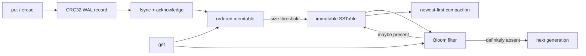

# lsm-tree

A dependency-free C++17 log-structured merge-tree storage engine built from
first principles.

[](https://github.com/asp53826/lsm-tree/actions/workflows/ci.yml)


> A write is not complete because it reached a map. It is complete when a
> restart can prove it survived.

## What is actually implemented

- acknowledged writes survive process crashes through an `fsync`-backed,
  checksummed WAL;
- sorted memtables flush to immutable, checksummed SSTables;
- Bloom filters reject absent keys before table lookup;
- newest-version-wins reads span memory and multiple disk generations;
- tombstones prevent deleted values from resurfacing;
- compaction durably installs a replacement before deleting old generations;
- incomplete WAL tails are detected and repaired to the verified record
  boundary;
- SSTable corruption is rejected instead of silently returning suspect data.



## Measured, not implied

Apple M2 Pro, macOS, Apple Clang 17:

| Check | Result |
|---|---:|
| Correctness assertions | **4,061 passed** |
| Seeded differential operations | 2,000 across five restarts |
| Randomized hard-crash rounds | 100 |
| Independently acknowledged writes lost | **0** |
| Synchronous write throughput | **34,708 ops/s** |
| Point-read throughput | **1.71M ops/s** |
| Benchmark records recovered | 20,000 / 20,000 |

The benchmark uses 20,000 writes and 20,000 seeded random reads. Writes call
`fsync`; reads run against immutable disk generations loaded into a compact
in-memory key index. These are local measurements, not universal hardware
claims.

## Verify it

```bash
make test
make crash-test
make benchmark
```

The crash campaign deliberately splits WAL and SSTable writes into seven-byte
chunks, kills the writer with uncatchable `SIGKILL` at seeded random times, and
compares every recovered state with a separately synced acknowledgement
oracle.

```bash
CRASH_ROUNDS=1000 make crash-test
```

## Disk structures

```text
active.wal
  [magic | sequence | put/delete | key_len | value_len | payload | CRC32]...

sst-N.dat
  [magic | version | entry_count | bloom metadata]
  [Bloom filter bytes]
  [sequence | tombstone | key_len | value_len | key | value]...
  [whole-file CRC32]
```

Flush ordering is deliberate: write temporary table → `fsync` table → atomic
rename → `fsync` directory → reset WAL. Compaction follows the same
install-before-delete rule and retains tombstones, so an interrupted cleanup
cannot expose an older value.

## Honest boundary

This is a compact educational engine, not a RocksDB replacement. It currently
has one writer, loads table indexes into memory, uses size-triggered full
compaction, and does not implement snapshots or concurrent readers. The tests
focus on the invariants those future features must preserve.

No database, serialization library, checksum package, Bloom-filter package, or
test framework is hidden behind the implementation.
